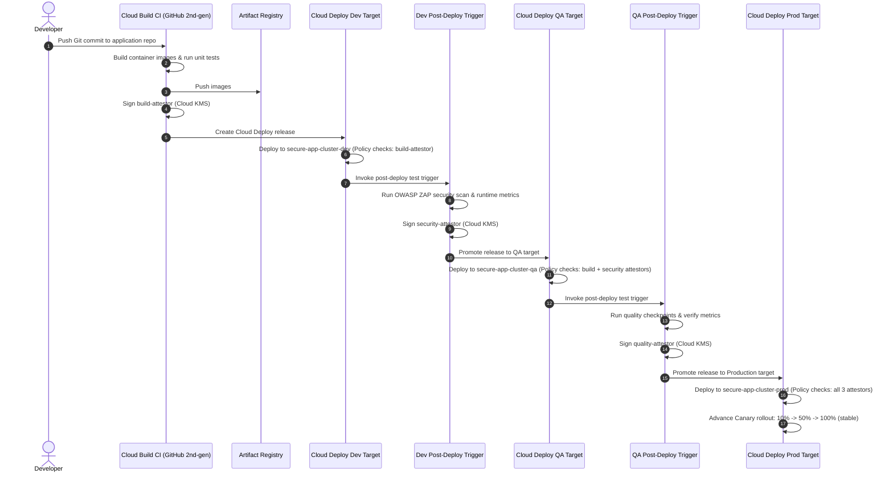
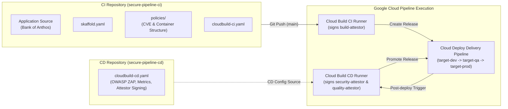

<!--
Copyright 2026 Google LLC

Licensed under the Apache License, Version 2.0 (the "License");
you may not use this file except in compliance with the License.
You may obtain a copy of the License at

     http://www.apache.org/licenses/LICENSE-2.0

Unless required by applicable law or agreed to in writing, software
distributed under the License is distributed on an "AS IS" BASIS,
WITHOUT WARRANTIES OR CONDITIONS OF ANY KIND, either express or implied.
See the License for the specific language governing permissions and
limitations under the License.
-->

# Deploying Secure CI/CD Pipeline on top of Terraform Example Foundation (v7.0.0+ / v8.0)

These instructions explain how to deploy the [Secure CI/CD Pipeline](https://github.com/GoogleCloudPlatform/terraform-google-secure-cicd) standalone single project example (`examples/standalone_single_project`) on top of the [Terraform Example Foundation](https://cloud.google.com/architecture/security-foundations/using-example-terraform) version [v7.0.0](https://github.com/terraform-google-modules/terraform-example-foundation/tree/v7.0.0) and [v8.0.0](https://github.com/terraform-google-modules/terraform-example-foundation/tree/v8.0.0).

The deployment uses the `production` environment of Business Unit 1 (`business_unit_1`) of an existing Terraform Example Foundation and deploys a hardened, end-to-end software supply chain security architecture, which provisions:

- A dedicated workload service project (`prj-p-bu1-secure-cicd-xxxx`) attached to the Foundation's restricted VPC Service Controls (VPC-SC) perimeter (`sp_svpc_default_common_perimeter_xxxx`),
- A dedicated spoke VPC network (`vpc-bu1-secure-cicd-spoke`) attached via **Network Connectivity Center (NCC) Spokes** to the Foundation's centralized enterprise NCC Hub,
- Three private Google Kubernetes Engine (GKE) clusters across development, QA, and production environments (`secure-app-cluster-dev`, `secure-app-cluster-qa`, `secure-app-cluster-prod`) registered with GKE Fleet and Connect Gateway for IAM-governed cluster management,
- Artifact Registry repositories with Binary Authorization attestations and Cloud KMS CMEK encryption,
- Cloud Build 2nd-generation GitHub/GitLab connections leveraging Secret Manager for secure credentials management within VPC-SC boundaries,
- A multi-attestor **Binary Authorization** supply chain security gate enforcing cryptographic signatures at each promotion gate:
  - `build-attestor`: signed in CI build upon image compilation and vulnerability scanning,
  - `security-attestor`: signed upon Dev post-deployment verification (OWASP ZAP scan and runtime metrics),
  - `quality-attestor`: signed upon QA post-deployment quality and stability verification,
- Cloud Deploy delivery pipelines (`secure-app-pipeline`) orchestrating multi-target promotion (`target-dev`, `target-qa`, `target-prod`) with automated deployment verification and progressive canary rollouts (10% → 50% → 100%),
- Dynamic, least-privilege egress firewall rules attached to the Foundation network security policy (`fp-bu1-firewalls`) to enforce zero-trust egress while enabling GKE master control plane and intra-cluster microservice communications (including CoreDNS resolution),
- The Bank of Anthos 9-microservice reference application.

The following Foundation infrastructure will be created or reused:

- The restricted VPC Service Controls (VPC-SC) perimeter and Hub-and-Spoke network created in Foundation steps `1-org`, `2-environments`, and `3-networks-hub-and-spoke` (or `3-networks-dual-svpc`).
- The **Network Connectivity Center (NCC) Hub** (`projects/<INTERCONNECT_PROJECT_ID>/locations/global/hubs/bu1-ncc-hub`) hosted in the centralized Interconnect / Hub project.
- The Business Unit 1 service project (`prj-p-bu1-secure-cicd-xxxx`) created in Foundation step `4-projects`.
- The application infrastructure pipeline repository (`bu1-example-app`) created in Foundation step `4-projects/business_unit_1/shared`.
- All organization policies, IAM service account role bindings, APIs, and VPC-SC perimeter ingress/egress rules are **100% managed declaratively by the Foundation steps**.

---

## Architecture Overview

```mermaid
flowchart TD
    subgraph Foundation["Enterprise Foundation (Hub-and-Spoke / NCC)"]
        HUB_PRJ["Hub Project (prj-c-bu1-ncc-hub)"]
        HUB["Network Connectivity Center (NCC) Hub\n(bu1-ncc-hub)"]
        HUB_PRJ --> HUB

        PERIMETER["VPC-SC Restricted Perimeter\n(sp_svpc_default_common_perimeter)"]
    end

    subgraph WorkloadProject["Workload Project: prj-p-bu1-secure-cicd-xxxx"]
        SPOKE_VPC["Spoke VPC Network\n(vpc-bu1-secure-cicd-spoke)"]

        subgraph DevEnv["Development Environment"]
            DEV_SUBNET["Subnet: 10.1.0.0/17"]
            DEV_GKE["GKE: secure-app-cluster-dev\n(Master: 172.16.1.0/28)"]
            DEV_TARGET["Cloud Deploy: target-dev\n(Requires: build-attestor)"]
        end

        subgraph QAEnv["QA Environment"]
            QA_SUBNET["Subnet: 10.2.0.0/17"]
            QA_GKE["GKE: secure-app-cluster-qa\n(Master: 172.16.2.0/28)"]
            QA_TARGET["Cloud Deploy: target-qa\n(Requires: build + security attestors)"]
        end

        subgraph ProdEnv["Production Environment"]
            PROD_SUBNET["Subnet: 10.3.0.0/17"]
            PROD_GKE["GKE: secure-app-cluster-prod\n(Master: 172.16.3.0/28)"]
            PROD_TARGET["Cloud Deploy: target-prod\n(Requires: build + security + quality)\nCanary: 10% -> 50% -> 100%"]
        end

        KMS["Cloud KMS CMEK & Attestor Keys\n(ASYMMETRIC_SIGN)"]
        AR["Artifact Registry\n(Container Images)"]
        FLEET["GKE Fleet Memberships\n& Connect Gateway"]

        SPOKE_VPC --> DEV_SUBNET --> DEV_GKE
        SPOKE_VPC --> QA_SUBNET --> QA_GKE
        SPOKE_VPC --> PROD_SUBNET --> PROD_GKE
    end

    SPOKE_VPC -.->|"NCC Spoke Attachment"| HUB
    PERIMETER -.-> WorkloadProject
```



---

## Supply Chain Security & Binary Authorization Workflow



---

## Zero-Trust Egress Firewall Policy & Dynamic Rules

The Terraform Example Foundation enforces a **zero-trust default deny egress rule** (`65530 DENY 0.0.0.0/0`) on the hierarchical/VPC firewall policy (`fp-bu1-firewalls`). 

To allow private GKE clusters, worker nodes, and microservices to communicate without breaking zero-trust isolation, dynamic egress firewall rules are declared using Terraform `data` sources:

1. **Rule 1000 (`fw-bu1-svpc-1000-e-a-allow-google-apis`)**: Permits egress to Google APIs Restricted VIP (`10.17.0.11:443`) for Cloud Build, Connect Gateway, Artifact Registry, Cloud KMS, and Container Analysis.
2. **Rule 1100 (`fw-bu1-svpc-1100-e-a-allow-gke-master-tcp-443-10250`)**: Dynamically extracts master `/28` control plane CIDRs (`172.16.1.0/28`, `172.16.2.0/28`, `172.16.3.0/28`) from `data.google_container_cluster` and allows Kubelet registration and control plane traffic on `TCP 443` and `TCP 10250`.
3. **Rule 1200 (`fw-bu1-svpc-1200-e-a-allow-gke-cluster-internal`)**: Dynamically extracts Pod CIDRs (`10.11.0.0/16`, `10.12.0.0/16`, `10.13.0.0/16`) and Service CIDRs (`10.101.0.0/20`, `10.102.0.0/20`, `10.103.0.0/20`) and permits:
   - `UDP 53` & `TCP 53` for CoreDNS cluster DNS resolution.
   - `TCP 80, 5432, 8080` for backend microservices and databases (PostgreSQL, Spring Boot services, Frontend).

---

## Prerequisites

### Code
- [terraform-example-foundation](https://github.com/terraform-google-modules/terraform-example-foundation/tree/v7.0.0) version `v7.0.0` or `v8.0.0` deployed through at least step `4-projects`.
- You must have the **Service Account User** (`roles/iam.serviceAccountUser`) role on the Terraform Service Accounts created in the foundation Seed Project:
  - `sa-terraform-bootstrap@<SEED_PROJECT_ID>.iam.gserviceaccount.com`
  - `sa-terraform-env@<SEED_PROJECT_ID>.iam.gserviceaccount.com`
  - `sa-terraform-net@<SEED_PROJECT_ID>.iam.gserviceaccount.com`
  - `sa-terraform-proj@<SEED_PROJECT_ID>.iam.gserviceaccount.com`

### Software
Install the following local dependencies:
- [Google Cloud SDK](https://cloud.google.com/sdk/install) version 487.0.0 or later.
- [Terraform](https://www.terraform.io/downloads.html) version 1.6 or later.
- [Git](https://git-scm.com/) version 2.28 or later.
- [kubectl](https://kubernetes.io/docs/tasks/tools/) version 1.28 or later.
- [jq](https://stedolan.github.io/jq/) version 1.6 or later.

### Cloud SDK Configuration
Ensure Application Default Credentials (ADC) are configured:

```bash
gcloud auth login
gcloud auth application-default login
```

---

## Directory Layout

For these instructions, we assume:
- Every Foundation repository is on the `production` branch and `terraform init` has been executed in each directory.
- The following folder layout exists in your local environment:

```text
gcp-bootstrap/
gcp-org/
gcp-environments/
gcp-networks/
gcp-projects/
bu1-example-app/
```

---

## Step 1: `4-projects` — Create Dedicated Secure CI/CD Workload Project

All Google Cloud APIs, IAM roles, Spoke VPC subnets, and Secret Manager access must be defined declaratively in Stage `4-projects`.

### 1.1. Create `gcp-projects/modules/base_env/secure_cicd_ncc_project.tf`

Create `gcp-projects/modules/base_env/secure_cicd_ncc_project.tf` with the project definition, VPC spoke network, subnets for Dev/QA/Prod, and required IAM permissions:

```hcl
/**
 * Copyright 2026 Google LLC
 *
 * Licensed under the Apache License, Version 2.0 (the "License");
 * you may not use this file except in compliance with the License.
 * You may obtain a copy of the License at
 *
 *      http://www.apache.org/licenses/LICENSE-2.0
 *
 * Unless required by applicable law or agreed to in writing, software
 * distributed under the License is distributed on an "AS IS" BASIS,
 * WITHOUT WARRANTIES OR CONDITIONS OF ANY KIND, either express or implied.
 * See the License for the specific language governing permissions and
 * limitations under the License.
 */

module "secure_cicd_project" {
  source = "../single_project"

  org_id                   = local.org_id
  billing_account          = local.billing_account
  folder_id                = google_folder.env_business_unit.name
  environment              = var.env
  project_budget           = var.project_budget
  project_prefix           = local.project_prefix
  universe_prefix          = local.universe_prefix
  billing_budget_available = local.available_universe_services.billing_budget

  project_deletion_policy = var.project_deletion_policy

  vpc_service_control_attach_enabled = local.enforce_vpcsc ? "true" : "false"
  vpc_service_control_attach_dry_run = !local.enforce_vpcsc ? "true" : "false"
  vpc_service_control_perimeter_name = "accessPolicies/${local.access_context_manager_policy_id}/servicePerimeters/${local.perimeter_name}"
  vpc_service_control_sleep_duration = "60s"

  enable_cloudbuild_deploy            = local.enable_cloudbuild_deploy
  app_infra_pipeline_service_accounts = local.app_infra_pipeline_service_accounts

  sa_roles = {
    "${var.business_code}-example-app" = [
      "roles/compute.networkAdmin",
      "roles/compute.securityAdmin",
      "roles/container.admin",
      "roles/container.clusterAdmin",
      "roles/gkehub.admin",
      "roles/cloudkms.admin",
      "roles/cloudkms.viewer",
      "roles/cloudkms.signerVerifier",
      "roles/cloudkms.cryptoKeyEncrypterDecrypter",
      "roles/secretmanager.secretAccessor",
      "roles/secretmanager.admin",
      "roles/artifactregistry.admin",
      "roles/clouddeploy.admin",
      "roles/binaryauthorization.admin",
      "roles/containeranalysis.admin",
      "roles/storage.admin",
      "roles/pubsub.editor",
      "roles/cloudbuild.builds.editor",
      "roles/cloudbuild.connectionAdmin",
      "roles/cloudbuild.admin",
      "roles/serviceusage.serviceUsageAdmin",
      "roles/resourcemanager.projectIamAdmin",
      "roles/iam.serviceAccountUser",
      "roles/iam.serviceAccountAdmin",
    ]
  }

  activate_apis = [
    "serviceusage.googleapis.com",
    "cloudresourcemanager.googleapis.com",
    "compute.googleapis.com",
    "dns.googleapis.com",
    "networkconnectivity.googleapis.com",
    "container.googleapis.com",
    "gkehub.googleapis.com",
    "gkeconnect.googleapis.com",
    "connectgateway.googleapis.com",
    "anthos.googleapis.com",
    "cloudkms.googleapis.com",
    "secretmanager.googleapis.com",
    "cloudbuild.googleapis.com",
    "clouddeploy.googleapis.com",
    "artifactregistry.googleapis.com",
    "binaryauthorization.googleapis.com",
    "containeranalysis.googleapis.com",
    "containerscanning.googleapis.com",
    "ondemandscanning.googleapis.com",
    "iamcredentials.googleapis.com",
    "logging.googleapis.com",
    "monitoring.googleapis.com",
    "accesscontextmanager.googleapis.com",
    "servicenetworking.googleapis.com"
  ]

  # Metadata
  project_suffix    = "secure-cicd"
  application_name  = "${var.business_code}-secure-cicd"
  billing_code      = "1234"
  primary_contact   = "example@example.com"
  secondary_contact = "example2@example.com"
  business_code     = var.business_code
}

module "secure_cicd_ncc_vpc" {
  source  = "terraform-google-modules/network/google//modules/foundation/network"
  version = "~> 18.2"

  project_id      = module.secure_cicd_project.project_id
  vpc_name        = "secure-cicd-spoke"
  shared_vpc_host = false

  resource_code              = var.business_code
  private_service_connect_ip = var.ncc_private_service_connect_ip

  ncc_hub_config = {
    create_hub  = false
    uri         = local.ncc_hub_uri
    spoke_group = local.ncc_spoke_group
  }

  subnets = [
    {
      subnet_name           = "sb-${var.env}-secure-cicd-${var.subnet_region}"
      subnet_ip             = "10.104.0.0/24"
      subnet_region         = var.subnet_region
      subnet_private_access = "true"
    },
    {
      subnet_name           = "secure-app-subnet-dev"
      subnet_ip             = "10.1.0.0/17"
      subnet_region         = var.subnet_region
      subnet_private_access = "true"
    },
    {
      subnet_name           = "secure-app-subnet-qa"
      subnet_ip             = "10.2.0.0/17"
      subnet_region         = var.subnet_region
      subnet_private_access = "true"
    },
    {
      subnet_name           = "secure-app-subnet-prod"
      subnet_ip             = "10.3.0.0/17"
      subnet_region         = var.subnet_region
      subnet_private_access = "true"
    }
  ]

  secondary_ranges = {
    "secure-app-subnet-dev" = [
      {
        range_name    = "secure-app-subnet-dev-gke-pods"
        ip_cidr_range = "10.11.0.0/16"
      },
      {
        range_name    = "secure-app-subnet-dev-gke-services"
        ip_cidr_range = "10.101.0.0/20"
      }
    ],
    "secure-app-subnet-qa" = [
      {
        range_name    = "secure-app-subnet-qa-gke-pods"
        ip_cidr_range = "10.12.0.0/16"
      },
      {
        range_name    = "secure-app-subnet-qa-gke-services"
        ip_cidr_range = "10.102.0.0/20"
      }
    ],
    "secure-app-subnet-prod" = [
      {
        range_name    = "secure-app-subnet-prod-gke-pods"
        ip_cidr_range = "10.13.0.0/16"
      },
      {
        range_name    = "secure-app-subnet-prod-gke-services"
        ip_cidr_range = "10.103.0.0/20"
      }
    ]
  }
}

resource "google_project_iam_member" "sa_secrets_admin" {
  count   = lookup(local.app_infra_pipeline_service_accounts, "${var.business_code}-example-app", null) != null ? 1 : 0
  project = local.env_secrets_project_id
  role    = "roles/secretmanager.admin"
  member  = "serviceAccount:${local.app_infra_pipeline_service_accounts["${var.business_code}-example-app"]}"
}
```

### 1.2. Export Project Outputs

Add outputs in `gcp-projects/modules/base_env/outputs.tf` and pass them through `gcp-projects/business_unit_1/production/outputs.tf`:

```hcl
output "secure_cicd_project_id" {
  description = "Project ID for Secure CI/CD workload project."
  value       = module.secure_cicd_project.project_id
}

output "secure_cicd_project_number" {
  description = "Project number for Secure CI/CD workload project."
  value       = module.secure_cicd_project.project_number
}

output "secure_cicd_spoke_network_name" {
  description = "Network name for Secure CI/CD NCC Spoke VPC."
  value       = module.secure_cicd_ncc_vpc.network_name
}

output "env_secrets_project_id" {
  description = "Project ID for Environment Secrets project."
  value       = local.env_secrets_project_id
}
```

And in `gcp-projects/business_unit_1/production/outputs.tf`:

```hcl
output "secure_cicd_project_id" {
  description = "Project ID for Secure CI/CD workload project."
  value       = module.env.secure_cicd_project_id
}

output "secure_cicd_project_number" {
  description = "Project number for Secure CI/CD workload project."
  value       = module.env.secure_cicd_project_number
}

output "secure_cicd_spoke_network_name" {
  description = "Network name for Secure CI/CD NCC Spoke VPC."
  value       = module.env.secure_cicd_spoke_network_name
}

output "env_secrets_project_id" {
  description = "Project ID for Environment Secrets project."
  value       = module.env.env_secrets_project_id
}
```

### 1.3. Create Cloud Build 2nd-Gen Authentication Secrets (GitHub or GitLab)

The Secure CI/CD module supports two external Git repository providers using Cloud Build 2nd-generation connections:
- **GitHub (`repository_type = "GITHUB"`)**
- **GitLab (`repository_type = "GITLAB"`)** (supports both GitLab.com and self-hosted GitLab Enterprise)

In Google Cloud Foundation, secrets are centralized in the **Environment Secrets Project** (`prj-p-secrets-xxxx` / `local.env_secrets_project_id`) created in Stage `2-environments`.

Retrieve the environment secrets project ID dynamically from the Foundation remote state:
```bash
export SECRETS_PROJECT_ID=$(terraform -chdir="gcp-environments/envs/production" output -raw env_secrets_project_id)
echo "Secrets Project ID: ${SECRETS_PROJECT_ID}"
```

#### Option A: GitHub Authentication Secrets (`repository_type = "GITHUB"`)
When deploying with GitHub, create the GitHub Personal Access Token (PAT) and GitHub App ID secrets:

1. **GitHub Personal Access Token (`github-pat`)**:
   ```bash
   echo -n "<YOUR_GITHUB_PERSONAL_ACCESS_TOKEN>" | gcloud secrets create github-pat \
     --project=${SECRETS_PROJECT_ID} \
     --data-file=- \
     --replication-policy="automatic" \
     --rotation-period="2592000s" \
     --next-rotation-time="$(date -u -d '+30 days' +%Y-%m-%dT%H:%M:%SZ 2>/dev/null || date -u -v+30d +%Y-%m-%dT%H:%M:%SZ)"
   ```

2. **GitHub App ID (`github-app-id`)**:
   ```bash
   echo -n "<YOUR_GITHUB_APP_ID>" | gcloud secrets create github-app-id \
     --project=${SECRETS_PROJECT_ID} \
     --data-file=- \
     --replication-policy="automatic" \
     --rotation-period="2592000s" \
     --next-rotation-time="$(date -u -d '+30 days' +%Y-%m-%dT%H:%M:%SZ 2>/dev/null || date -u -v+30d +%Y-%m-%dT%H:%M:%SZ)"
   ```

#### Option B: GitLab Authentication Secrets (`repository_type = "GITLAB"`)
When deploying with GitLab (GitLab.com or self-hosted GitLab Enterprise), create the authorizer token, read token, and webhook secrets:

1. **GitLab Authorizer Personal Access Token (`gitlab-pat`)**:
   Requires `api` and `read_api` scopes to manage repository connections and webhooks.
   ```bash
   echo -n "<YOUR_GITLAB_AUTHORIZER_PAT>" | gcloud secrets create gitlab-pat \
     --project=${SECRETS_PROJECT_ID} \
     --data-file=- \
     --replication-policy="automatic" \
     --rotation-period="2592000s" \
     --next-rotation-time="$(date -u -d '+30 days' +%Y-%m-%dT%H:%M:%SZ 2>/dev/null || date -u -v+30d +%Y-%m-%dT%H:%M:%SZ)"
   ```

2. **GitLab Read Authorizer Token (`gitlab-read-token`)**:
   Requires `read_api` scope for Cloud Build worker clones.
   ```bash
   echo -n "<YOUR_GITLAB_READ_TOKEN>" | gcloud secrets create gitlab-read-token \
     --project=${SECRETS_PROJECT_ID} \
     --data-file=- \
     --replication-policy="automatic" \
     --rotation-period="2592000s" \
     --next-rotation-time="$(date -u -d '+30 days' +%Y-%m-%dT%H:%M:%SZ 2>/dev/null || date -u -v+30d +%Y-%m-%dT%H:%M:%SZ)"
   ```

3. **GitLab Webhook Secret (`gitlab-webhook-secret`)**:
   A random secret string used by Cloud Build to validate incoming GitLab webhooks.
   ```bash
   openssl rand -base64 24 | tr -d '\n' | gcloud secrets create gitlab-webhook-secret \
     --project=${SECRETS_PROJECT_ID} \
     --data-file=- \
     --replication-policy="automatic" \
     --rotation-period="2592000s" \
     --next-rotation-time="$(date -u -d '+30 days' +%Y-%m-%dT%H:%M:%SZ 2>/dev/null || date -u -v+30d +%Y-%m-%dT%H:%M:%SZ)"
   ```

> [!IMPORTANT]
> **Why Explicit Secret Replication & Rotation Policy Configuration Is Critical:**
> - **Replication Policy:** In enterprise environments governed by Google Cloud Foundation, organization policies (`constraints/gcp.resourceLocations` or `constraints/secretmanager.restrictReplication`) enforce strict data residency and high availability requirements. Explicitly specifying `--replication-policy="automatic"` (or user-managed regional replication matching your Foundation primary/secondary regions) ensures your secrets conform to organization policy constraints and maintain high availability across regions.
> - **30-Day Rotation Schedule:** Setting `--rotation-period="2592000s"` (30 days) enforces security compliance for rotating external API access credentials.
> - **Cross-Project Access:** In Foundation Step 1.1, the resource `google_project_iam_member.sa_secrets_admin` automatically grants `roles/secretmanager.admin` on the secrets project to the application infrastructure pipeline service account (`sa-tf-bu1-example-app@...`). This allows Terraform to verify the secrets and grant Cloud Build's Service Agent (`service-<PROJECT_NUMBER>@gcp-sa-cloudbuild.iam.gserviceaccount.com`) read access (`roles/secretmanager.secretAccessor`) during GitHub/GitLab connection provisioning.

### 1.4. Commit and Apply `4-projects`

```bash
cd gcp-projects
git checkout production
git add modules/base_env/secure_cicd_ncc_project.tf modules/base_env/outputs.tf business_unit_1/production/outputs.tf
git commit -m "feat: add secure cicd workload project and spoke vpc"
git push origin production
```

Retrieve the project outputs:

```bash
terraform -chdir="business_unit_1/production" init
export SERVICE_PROJECT_ID=$(terraform -chdir="business_unit_1/production" output -raw secure_cicd_project_id)
export SERVICE_PROJECT_NUMBER=$(terraform -chdir="business_unit_1/production" output -raw secure_cicd_project_number)

echo "Workload Project ID:     ${SERVICE_PROJECT_ID}"
echo "Workload Project Number: ${SERVICE_PROJECT_NUMBER}"
```

---

## Step 2: `1-org` — Configure Workload VPC-SC Ingress & Egress Rules

All VPC Service Controls perimeter configurations must be governed centrally in Foundation Stage `1-org`.

In an enterprise Google Cloud Foundation deployment, deploying the Secure CI/CD pipeline involves interactions across multiple participating projects within the VPC Service Controls perimeter:
1. **Workload Project** (`prj-p-bu1-secure-cicd-xxxx`): Hosts the GKE clusters, Cloud Deploy delivery pipelines, Artifact Registry image repositories, and runtime service endpoints.
2. **Application Infrastructure Pipeline Project** (`prj-c-bu1-infra-pipeline-xxxx`): Hosts the Cloud Build GitOps runner, state buckets, and service accounts.
3. **Environment Secrets Project** (`prj-p-secrets-xxxx`): Hosts Secret Manager secrets for GitHub/GitLab 2nd-gen repository authentication (GitHub App private key, App ID, personal access tokens).
4. **Environment KMS Project** (`prj-p-kms-xxxx`): Hosts Cloud KMS CMEK encryption keys and Binary Authorization asymmetric signing keys.
5. **Centralized Network Hub & Spoke Projects** (`prj-c-bu1-ncc-hub-xxxx` / `prj-p-spoke-xxxx`): Hosts the Network Connectivity Center (NCC) Hub, spoke groups, and spoke VPC routes.
6. **Shared CI/CD Project** (`prj-b-cicd-xxxx`): Hosts shared enterprise CI/CD runners, base container repositories, and central build artifacts.

When VPC Service Controls are enforced (`enforce_vpcsc = true`), you must declare the project numbers of all participating projects in `gcp-org/envs/shared/terraform.tfvars`.

### 2.1. Retrieve Project Numbers of All Participating Foundation Projects

Retrieve the numeric project IDs for all participating projects from your Foundation remote states:

```bash
# Set default region and business code
export REGION=${REGION:-us-central1}
export BUSINESS_CODE=${BUSINESS_CODE:-bu1}

# 1. Retrieve Workload Project Number (from Step 1)
export WORKLOAD_PROJECT_NUMBER=$(terraform -chdir="gcp-projects/business_unit_1/production" output -raw secure_cicd_project_number)

# 2. Retrieve App Infra Pipeline Project Number
export INFRA_PIPELINE_PROJECT_ID=$(terraform -chdir="gcp-projects/business_unit_1/shared" output -raw cloudbuild_project_id)
export INFRA_PIPELINE_PROJECT_NUMBER=$(gcloud projects describe "${INFRA_PIPELINE_PROJECT_ID}" --format="value(projectNumber)")

# 3. Retrieve Secrets, KMS, and Spoke Network Project Numbers
export SECRETS_PROJECT_ID=$(terraform -chdir="gcp-environments/envs/production" output -raw env_secrets_project_id 2>/dev/null || terraform -chdir="gcp-projects/business_unit_1/production" output -raw env_secrets_project_id)
export SECRETS_PROJECT_NUMBER=$(gcloud projects describe "${SECRETS_PROJECT_ID}" --format="value(projectNumber)")

export KMS_PROJECT_ID=$(terraform -chdir="gcp-environments/envs/production" output -raw env_kms_project_id 2>/dev/null || terraform -chdir="gcp-projects/business_unit_1/production" output -raw env_kms_project_id)
export KMS_PROJECT_NUMBER=$(gcloud projects describe "${KMS_PROJECT_ID}" --format="value(projectNumber)")

export NCC_HUB_PROJECT_ID=$(terraform -chdir="gcp-networks/envs/production" output -raw interconnect_project_id)
export NCC_HUB_PROJECT_NUMBER=$(gcloud projects describe "${NCC_HUB_PROJECT_ID}" --format="value(projectNumber)")

export SHARED_CICD_PROJECT_ID=$(terraform -chdir="gcp-bootstrap/envs/shared" output -raw cicd_project_id 2>/dev/null || terraform -chdir="gcp-bootstrap" output -raw cicd_project_id)
export SHARED_CICD_PROJECT_NUMBER=$(gcloud projects describe "${SHARED_CICD_PROJECT_ID}" --format="value(projectNumber)")

echo "Workload Project Number:        ${WORKLOAD_PROJECT_NUMBER}"
echo "Infra Pipeline Project Number:  ${INFRA_PIPELINE_PROJECT_NUMBER}"
echo "Secrets Project Number:         ${SECRETS_PROJECT_NUMBER}"
echo "KMS Project Number:             ${KMS_PROJECT_NUMBER}"
echo "NCC Hub Project Number:         ${NCC_HUB_PROJECT_NUMBER}"
echo "Shared CI/CD Project Number:    ${SHARED_CICD_PROJECT_NUMBER}"
```

### 2.2. Update `gcp-org/envs/shared/terraform.tfvars`

Add the list of project numbers to `app_infra_target_project_numbers` and configure the comprehensive `secure_cicd_infra_workload_ingress` rule in `ingress_policies_map` (and `ingress_policies_dry_run_map` if evaluating in dry-run mode):

```hcl
# Enable built-in Foundation application infrastructure ingress/egress rules
required_egress_rules_app_infra  = true
required_ingress_rules_app_infra = true

# Declare all target project numbers accessed by the application infrastructure pipeline
app_infra_target_project_numbers = [
  "WORKLOAD_PROJECT_NUMBER",        # (Workload & GKE Project)
  "INFRA_PIPELINE_PROJECT_NUMBER", # (App Infra Cloud Build Project)
  "SECRETS_PROJECT_NUMBER",        # (Environment Secrets Project)
  "KMS_PROJECT_NUMBER",            # (Environment KMS Project)
  "NCC_HUB_PROJECT_NUMBER",        # (NCC Hub & Interconnect Project)
  "SHARED_CICD_PROJECT_NUMBER"     # (Shared CI/CD Project)
]

# Explicit Ingress Policy allowing Cross-Project Workload and CI/CD Operations
ingress_policies_map = {
  "secure_cicd_infra_workload_ingress" = {
    title = "Secure CI/CD Infrastructure and Workload Ingress"
    from = {
      identity_type = "ANY_IDENTITY"
      sources = {
        access_levels = ["*"]
      }
    }
    to = {
      resources = [
        "projects/WORKLOAD_PROJECT_NUMBER",
        "projects/INFRA_PIPELINE_PROJECT_NUMBER",
        "projects/SECRETS_PROJECT_NUMBER",
        "projects/KMS_PROJECT_NUMBER",
        "projects/NCC_HUB_PROJECT_NUMBER",
        "projects/SHARED_CICD_PROJECT_NUMBER"
      ]
      operations = {
        "storage.googleapis.com" = {
          methods = ["*"]
        }
        "logging.googleapis.com" = {
          methods = ["*"]
        }
        "artifactregistry.googleapis.com" = {
          methods = ["*"]
        }
        "clouddeploy.googleapis.com" = {
          methods = ["*"]
        }
        "gkehub.googleapis.com" = {
          methods = ["*"]
        }
        "connectgateway.googleapis.com" = {
          methods = ["*"]
        }
        "binaryauthorization.googleapis.com" = {
          methods = ["*"]
        }
        "cloudkms.googleapis.com" = {
          methods = ["*"]
        }
        "containeranalysis.googleapis.com" = {
          methods = ["*"]
        }
        "iamcredentials.googleapis.com" = {
          methods = ["*"]
        }
        "secretmanager.googleapis.com" = {
          methods = ["*"]
        }
        "servicenetworking.googleapis.com" = {
          methods = ["*"]
        }
        "serviceusage.googleapis.com" = {
          methods = ["*"]
        }
        "container.googleapis.com" = {
          methods = ["*"]
        }
        "compute.googleapis.com" = {
          methods = ["*"]
        }
        "cloudbuild.googleapis.com" = {
          methods = ["*"]
        }
        "iam.googleapis.com" = {
          methods = ["*"]
        }
        "cloudresourcemanager.googleapis.com" = {
          methods = ["*"]
        }
        "dns.googleapis.com" = {
          methods = ["*"]
        }
        "pubsub.googleapis.com" = {
          methods = ["*"]
        }
      }
    }
  }
}
```

> [!NOTE]
> Replace `WORKLOAD_PROJECT_NUMBER`, `INFRA_PIPELINE_PROJECT_NUMBER`, `SECRETS_PROJECT_NUMBER`, `KMS_PROJECT_NUMBER`, `NCC_HUB_PROJECT_NUMBER`, and `SHARED_CICD_PROJECT_NUMBER` with the numeric project IDs retrieved in Step 2.1.

### 2.3. Commit and Apply `1-org`

Commit and push the changes to execute `terraform apply` via your Foundation CI/CD pipeline (or direct local execution):

```bash
cd gcp-org
git checkout production
git add envs/shared/terraform.tfvars
git commit -m "feat: add multi-project secure cicd ingress policies to vpc-sc perimeter"
git push origin production
```

---

## Step 3: Deploy Application Infrastructure (`5-app-infra` / `bu1-example-app`)

Deploy the Secure CI/CD infrastructure module and the dynamic least-privilege egress firewall rules through the GitOps application infrastructure pipeline.

### 3.1. Configure `bu1-example-app/business_unit_1/production/secure_cicd.tf`

Create `bu1-example-app/business_unit_1/production/secure_cicd.tf` with the appropriate repository configuration for **GitHub** or **GitLab**:

#### Option A: GitHub Deployment (`repository_type = "GITHUB"`)

```hcl
/**
 * Copyright 2026 Google LLC
 *
 * Licensed under the Apache License, Version 2.0 (the "License");
 * you may not use this file except in compliance with the License.
 * You may obtain a copy of the License at
 *
 *      http://www.apache.org/licenses/LICENSE-2.0
 *
 * Unless required by applicable law or agreed to in writing, software
 * distributed under the License is distributed on an "AS IS" BASIS,
 * WITHOUT WARRANTIES OR CONDITIONS OF ANY KIND, either express or implied.
 * See the License for the specific language governing permissions and
 * limitations under the License.
 */

module "secure_cicd" {
  source = "git::https://github.com/GoogleCloudPlatform/terraform-google-secure-cicd.git//examples/standalone_single_project?ref=main"

  project_id             = data.terraform_remote_state.projects_env.outputs.secure_cicd_project_id
  region                 = local.default_region
  app_name               = "secure-app"
  private_worker_pool_id = null
  network_name           = data.terraform_remote_state.projects_env.outputs.secure_cicd_spoke_network_name

  repository_type = "GITHUB"
  github_auth = {
    secret_id         = "projects/${data.terraform_remote_state.projects_env.outputs.env_secrets_project_id}/secrets/github-pat/versions/latest"
    app_id_secret_id  = "projects/${data.terraform_remote_state.projects_env.outputs.env_secrets_project_id}/secrets/github-app-id/versions/latest"
    secret_project_id = data.terraform_remote_state.projects_env.outputs.env_secrets_project_id
  }

  ci_repository = {
    repository_name = "<YOUR_GITHUB_ORG>/secure-pipeline-foundation-ci"
    repository_url  = "https://github.com/<YOUR_GITHUB_ORG>/secure-pipeline-foundation-ci.git"
  }

  cd_repository = {
    repository_name = "<YOUR_GITHUB_ORG>/secure-pipeline-foundation-cd"
    repository_url  = "https://github.com/<YOUR_GITHUB_ORG>/secure-pipeline-foundation-cd.git"
  }

  labels = {
    environment   = local.environment
    business_unit = local.business_unit
    managed_by    = "foundation-gitops"
  }
}
```

#### Option B: GitLab Deployment (`repository_type = "GITLAB"`)

```hcl
module "secure_cicd" {
  source = "git::https://github.com/GoogleCloudPlatform/terraform-google-secure-cicd.git//examples/standalone_single_project?ref=main"

  project_id             = data.terraform_remote_state.projects_env.outputs.secure_cicd_project_id
  region                 = local.default_region
  app_name               = "secure-app"
  private_worker_pool_id = null
  network_name           = data.terraform_remote_state.projects_env.outputs.secure_cicd_spoke_network_name

  repository_type = "GITLAB"
  gitlab_auth = {
    authorizer_credential_secret_id      = "projects/${data.terraform_remote_state.projects_env.outputs.env_secrets_project_id}/secrets/gitlab-pat/versions/latest"
    read_authorizer_credential_secret_id = "projects/${data.terraform_remote_state.projects_env.outputs.env_secrets_project_id}/secrets/gitlab-read-token/versions/latest"
    webhook_secret_id                    = "projects/${data.terraform_remote_state.projects_env.outputs.env_secrets_project_id}/secrets/gitlab-webhook-secret/versions/latest"
    secret_project_id                    = data.terraform_remote_state.projects_env.outputs.env_secrets_project_id
    # Optional for self-hosted GitLab Enterprise:
    # enterprise_host_uri              = "https://gitlab.example.com"
    # enterprise_ca_certificate        = "projects/.../secrets/gitlab-ca-cert/versions/latest"
    # enterprise_service_directory     = "projects/.../locations/.../namespaces/.../services/..."
  }

  ci_repository = {
    repository_name = "<YOUR_GITLAB_GROUP>/secure-pipeline-foundation-ci"
    repository_url  = "https://gitlab.com/<YOUR_GITLAB_GROUP>/secure-pipeline-foundation-ci.git"
  }

  cd_repository = {
    repository_name = "<YOUR_GITLAB_GROUP>/secure-pipeline-foundation-cd"
    repository_url  = "https://gitlab.com/<YOUR_GITLAB_GROUP>/secure-pipeline-foundation-cd.git"
  }

  labels = {
    environment   = local.environment
    business_unit = local.business_unit
    managed_by    = "foundation-gitops"
  }
}
```

```hcl
# ---------------------------------------------------------------------------------------------------------------------
# Dynamic Zero-Trust Egress Firewall Rules (Attached to fp-<BUSINESS_CODE>-firewalls)
# ---------------------------------------------------------------------------------------------------------------------

data "google_container_cluster" "gke_clusters" {
  for_each = module.secure_cicd.gke_cluster_names

  name     = each.value
  location = local.default_region
  project  = data.terraform_remote_state.projects_env.outputs.secure_cicd_project_id

  depends_on = [module.secure_cicd]
}

resource "google_compute_network_firewall_policy_rule" "allow_gke_master_egress" {
  project         = data.terraform_remote_state.projects_env.outputs.secure_cicd_project_id
  firewall_policy = "fp-${local.business_unit}-firewalls"
  priority        = 1100
  rule_name       = "fw-${local.business_unit}-svpc-1100-e-a-allow-gke-master-tcp-443-10250"
  direction       = "EGRESS"
  action          = "allow"
  description     = "Allow egress from GKE worker nodes to private cluster master control planes"
  enable_logging  = true

  match {
    dest_ip_ranges = [
      for cluster in data.google_container_cluster.gke_clusters :
      cluster.private_cluster_config[0].master_ipv4_cidr_block
    ]
    layer4_configs {
      ip_protocol = "tcp"
      ports       = ["443", "10250"]
    }
  }
}

resource "google_compute_network_firewall_policy_rule" "allow_gke_cluster_internal_egress" {
  project         = data.terraform_remote_state.projects_env.outputs.secure_cicd_project_id
  firewall_policy = "fp-${local.business_unit}-firewalls"
  priority        = 1200
  rule_name       = "fw-${local.business_unit}-svpc-1200-e-a-allow-gke-cluster-internal"
  direction       = "EGRESS"
  action          = "allow"
  description     = "Allow intra-cluster egress between GKE pods and services across worker nodes including CoreDNS"
  enable_logging  = true

  match {
    dest_ip_ranges = distinct(flatten([
      [for cluster in data.google_container_cluster.gke_clusters : cluster.cluster_ipv4_cidr],
      [for cluster in data.google_container_cluster.gke_clusters : cluster.services_ipv4_cidr]
    ]))
    layer4_configs {
      ip_protocol = "tcp"
      ports       = ["53", "80", "5432", "8080"]
    }
    layer4_configs {
      ip_protocol = "udp"
      ports       = ["53"]
    }
  }
}
```

### 3.2. Commit and Apply `bu1-example-app`

Push the changes to execute `terraform apply` via the Cloud Build infrastructure pipeline:

```bash
cd bu1-example-app
git checkout production
git add business_unit_1/production/secure_cicd.tf
git commit -m "feat: deploy secure-cicd module and dynamic egress firewall rules"
git push origin production
```

---

## Step 4: Application Source, CI/CD Repositories & Promotion Workflow

The Secure CI/CD architecture strictly decouples **Continuous Integration (Application Source)** from **Continuous Delivery (Post-Deployment Verification & Promotion Policy)** across two distinct Git repositories.



### 4.1. CI vs. CD Repository Architectural Comparison

| Dimension | CI Repository (`ci_repository`) | CD Repository (`cd_repository`) |
| :--- | :--- | :--- |
| **Owner / Persona** | Application Developers & Product Teams | SecOps, Platform & QA Engineers |
| **Primary Responsibility** | Code compilation, unit testing, container packaging, security linting, vulnerability scanning, and initial release creation. | Automated runtime verification, dynamic application security testing (DAST), runtime health metrics, and promotion signing. |
| **Key Manifests** | `cloudbuild-ci.yaml`, `skaffold.yaml`, `policies/container-analysis-policy.yaml`, `policies/container-structure-policy.yaml`, `src/`, `kubernetes-manifests/` | `cloudbuild-cd.yaml` |
| **Attestations Signed** | **`build-attestor`** (via Cloud KMS asymmetric key upon passing container CVE analysis and structure tests). | **`security-attestor`** (upon passing Dev OWASP ZAP scans); **`quality-attestor`** (upon passing QA runtime metric checks). |
| **Trigger Mechanism** | Triggered automatically upon **Git push** to the default branch (`main` or matching regex). | Invoked via Cloud Deploy pub/sub notifications or executed via `gcloud builds triggers run` post-rollout. |

---

### 4.2. Setup Continuous Delivery Repository (`secure-pipeline-cd`)

The CD repository contains the post-deployment test automation pipeline (`cloudbuild-cd.yaml`).

#### Repository File Structure
```text
secure-pipeline-cd/
└── cloudbuild-cd.yaml    # Post-deploy tests (OWASP ZAP, metrics validation, promotion signing)
```

#### Step-by-Step Setup

1. Export the path to your local clone of the `terraform-google-secure-cicd` blueprint repository:
   ```bash
   export SECURE_CICD_REPO_DIR="<PATH_TO_LOCAL_TERRAFORM_GOOGLE_SECURE_CICD>"
   ```

2. Initialize a temporary local working directory:
   ```bash
   mkdir -p ~/secure-cicd-workspace/cd-repo
   cd ~/secure-cicd-workspace/cd-repo
   git init
   git checkout -b main
   ```

3. Copy `cloudbuild-cd.yaml` from your local clone:
   ```bash
   cp "${SECURE_CICD_REPO_DIR}/build/cloudbuild-cd.yaml" .
   ```

4. Commit and push the configuration to your remote Git provider:

   **Option A: GitHub**
   ```bash
   git add cloudbuild-cd.yaml
   git commit -m "feat: initial commit for post-deployment verification triggers"
   git remote add origin https://github.com/<YOUR_GITHUB_ORG>/secure-pipeline-foundation-cd.git
   git push -u origin main
   ```

   **Option B: GitLab (GitLab.com or Self-Hosted GitLab Enterprise)**
   ```bash
   git add cloudbuild-cd.yaml
   git commit -m "feat: initial commit for post-deployment verification triggers"
   git remote add origin https://gitlab.com/<YOUR_GITLAB_GROUP>/secure-pipeline-foundation-cd.git
   # For Self-Hosted GitLab Enterprise:
   # git remote add origin https://<YOUR_GITLAB_HOST>/<YOUR_GITLAB_GROUP>/secure-pipeline-foundation-cd.git
   git push -u origin main
   ```

---

### 4.3. Setup Continuous Integration Repository (`secure-pipeline-ci`)

The CI repository contains the Bank of Anthos application source code, Docker build files, Skaffold orchestration, container security policies, and the CI build definition (`cloudbuild-ci.yaml`).

#### Repository File Structure
```text
secure-pipeline-ci/
├── cloudbuild-ci.yaml                  # Cloud Build CI pipeline
├── skaffold.yaml                       # Multi-artifact Skaffold specification
├── policies/
│   ├── container-analysis-policy.yaml  # CVE vulnerability blocking criteria
│   └── container-structure-policy.yaml # Container structure and compliance tests
├── kubernetes-manifests/               # GKE deployment and service manifests
└── src/                                # 9 Bank of Anthos microservices source code
```

#### Step-by-Step Setup

1. Initialize the application working directory and clone the Bank of Anthos application source code:
   ```bash
   mkdir -p ~/secure-cicd-workspace/ci-repo
   cd ~/secure-cicd-workspace/ci-repo
   git clone --branch v0.5.11 https://github.com/GoogleCloudPlatform/bank-of-anthos.git .
   git checkout -b main
   ```

2. Copy the CI build pipeline and security policy definitions from your local `terraform-google-secure-cicd` clone:
   ```bash
   # Copy CI Cloud Build configuration
   cp "${SECURE_CICD_REPO_DIR}/build/cloudbuild-ci.yaml" .

   # Copy policies directory (vulnerability scanning and structure test policies)
   cp -r "${SECURE_CICD_REPO_DIR}/examples/app_cicd/policies" .
   ```

3. Commit and push the application code to your remote Git provider:

   **Option A: GitHub**
   ```bash
   git add .
   git commit -m "feat: initial commit for Bank of Anthos microservices and secure CI pipeline"
   git remote add origin https://github.com/<YOUR_GITHUB_ORG>/secure-pipeline-foundation-ci.git
   git push -u origin main
   ```

   **Option B: GitLab (GitLab.com or Self-Hosted GitLab Enterprise)**
   ```bash
   git add .
   git commit -m "feat: initial commit for Bank of Anthos microservices and secure CI pipeline"
   git remote add origin https://gitlab.com/<YOUR_GITLAB_GROUP>/secure-pipeline-foundation-ci.git
   # For Self-Hosted GitLab Enterprise:
   # git remote add origin https://<YOUR_GITLAB_HOST>/<YOUR_GITLAB_GROUP>/secure-pipeline-foundation-ci.git
   git push -u origin main
   ```

---

### 4.4. Continuous Integration Build & Multi-Attestor Promotion Progression

Set standard environment variables for your workload project and region:
```bash
export REGION=${REGION:-us-central1}
export SERVICE_PROJECT_ID=$(terraform -chdir="gcp-projects/business_unit_1/production" output -raw secure_cicd_project_id)
```

#### 1. Monitor CI Build & Automated Dev Deployment
Pushing to the `main` branch of `secure-pipeline-ci` automatically triggers the Cloud Build CI runner on the private worker pool:
1. Compiles container images using Skaffold.
2. Runs Container Structure Tests and on-demand Container Analysis CVE scans against `policies/`.
3. Cryptographically signs the container images with Cloud KMS using the **`build-attestor`** key.
4. Creates a Cloud Deploy release (`release-<SHORT_SHA>`) and initiates rollout to `target-dev-secure-pipeline`.

```bash
# Check CI build execution status
gcloud builds list --project=${SERVICE_PROJECT_ID} --region=${REGION} --limit=5

# Monitor Cloud Deploy Dev rollout status
gcloud deploy rollouts list \
  --delivery-pipeline=secure-app-pipeline \
  --project=${SERVICE_PROJECT_ID} \
  --region=${REGION}
```

#### 2. Execute Dev Post-Deployment Verification & Sign `security-attestor`
Once the Dev rollout completes with status `SUCCESS`, invoke the Dev post-deployment verification trigger:
1. Connects to `secure-app-cluster-dev` via Connect Gateway.
2. Discovers active service endpoints and executes an automated OWASP ZAP dynamic security scan.
3. Evaluates runtime health and crash-loop metrics.
4. Cryptographically signs the images with Cloud KMS using the **`security-attestor`** key.
5. Automatically promotes the release to `target-qa-secure-pipeline`.

```bash
DEV_TRIGGER_ID=$(gcloud builds triggers list \
  --project=${SERVICE_PROJECT_ID} \
  --region=${REGION} \
  --filter="name:deploy-trigger-secure-app-cluster-dev-membership" \
  --format="value(id)")

gcloud builds triggers run ${DEV_TRIGGER_ID} \
  --project=${SERVICE_PROJECT_ID} \
  --region=${REGION} \
  --branch=main
```

#### 3. Monitor QA Rollout & Execute QA Post-Deployment Verification
1. Cloud Deploy verifies that all images possess **both** `build-attestor` and `security-attestor` signatures before permitting deployment to `secure-app-cluster-qa`.
2. Once the QA rollout completes, execute the QA post-deployment verification trigger:

```bash
QA_TRIGGER_ID=$(gcloud builds triggers list \
  --project=${SERVICE_PROJECT_ID} \
  --region=${REGION} \
  --filter="name:deploy-trigger-secure-app-cluster-qa-membership" \
  --format="value(id)")

gcloud builds triggers run ${QA_TRIGGER_ID} \
  --project=${SERVICE_PROJECT_ID} \
  --region=${REGION} \
  --branch=main
```

> [!NOTE]
> Upon passing runtime metric and error-rate checks, the QA trigger cryptographically signs the images with the **`quality-attestor`** key.

#### 4. Promote Release to Production & Advance Progressive Canary Rollout
1. Cloud Deploy enforces that deployment to `secure-app-cluster-prod` requires **all three attestations** (`build-attestor`, `security-attestor`, and `quality-attestor`).
2. Promote the release to `target-prod-secure-pipeline`:

```bash
# Retrieve latest release name
RELEASE_NAME=$(gcloud deploy releases list \
  --delivery-pipeline=secure-app-pipeline \
  --project=${SERVICE_PROJECT_ID} \
  --region=${REGION} \
  --limit=1 \
  --format="value(name)")

# Promote release to production target
gcloud deploy releases promote \
  --release=${RELEASE_NAME} \
  --delivery-pipeline=secure-app-pipeline \
  --to-target=target-prod-secure-pipeline \
  --project=${SERVICE_PROJECT_ID} \
  --region=${REGION} \
  --quiet

# Advance progressive canary rollout: 10% -> 50% -> 100% (stable)
ROLLOUT_NAME=$(gcloud deploy rollouts list \
  --release=${RELEASE_NAME} \
  --delivery-pipeline=secure-app-pipeline \
  --target=target-prod-secure-pipeline \
  --project=${SERVICE_PROJECT_ID} \
  --region=${REGION} \
  --limit=1 \
  --format="value(name)")

gcloud deploy rollouts advance ${ROLLOUT_NAME} \
  --release=${RELEASE_NAME} \
  --delivery-pipeline=secure-app-pipeline \
  --project=${SERVICE_PROJECT_ID} \
  --region=${REGION} \
  --quiet
```

---

## Step 5: Verification & Workload Health

Connect to the GKE clusters via Connect Gateway and verify that all 9 Bank of Anthos microservices are `1/1 Running`:

```bash
# 1. Dev Cluster Verification
gcloud container fleet memberships get-credentials secure-app-cluster-dev-membership \
  --project=${SERVICE_PROJECT_ID} \
  --billing-project=${SERVICE_PROJECT_ID}
kubectl get pods,svc

# 2. QA Cluster Verification
gcloud container fleet memberships get-credentials secure-app-cluster-qa-membership \
  --project=${SERVICE_PROJECT_ID} \
  --billing-project=${SERVICE_PROJECT_ID}
kubectl get pods,svc

# 3. Production Cluster Verification
gcloud container fleet memberships get-credentials secure-app-cluster-prod-membership \
  --project=${SERVICE_PROJECT_ID} \
  --billing-project=${SERVICE_PROJECT_ID}
kubectl get pods,svc
```

### Microservice Verification Matrix

| Microservice | Port | Protocol | Function |
| :--- | :--- | :--- | :--- |
| `frontend` | 80 / 3xxxx | HTTP / LoadBalancer | Web user interface & external traffic ingress |
| `userservice` | 8080 | HTTP / ClusterIP | Authentication and user profile management |
| `contacts` | 8080 | HTTP / ClusterIP | Payee and contact address management |
| `accounts-db` | 5432 | PostgreSQL | User account ledger database |
| `ledger-db` | 5432 | PostgreSQL | Transaction ledger database |
| `balancereader` | 8080 | HTTP / ClusterIP | Account balance querying service |
| `ledgerwriter` | 8080 | HTTP / ClusterIP | Transaction write engine |
| `transactionhistory` | 8080 | HTTP / ClusterIP | Historical transaction ledger queries |
| `loadgenerator` | - | Background Worker | Periodic synthetic banking traffic simulator |

Verify the frontend endpoint via curl using the Load Balancer IP:

```bash
FRONTEND_IP=$(kubectl get svc frontend -o jsonpath='{.status.loadBalancer.ingress[0].ip}')
curl -I "http://${FRONTEND_IP}"
# Expected: HTTP/1.1 200 OK
```

---

## Teardown and Cleanup

To tear down the Secure CI/CD Pipeline and its supporting workload infrastructure within your Google Cloud Foundation environment, execute the cleanup in reverse GitOps order:

### 1. Destroy Application Infrastructure & Pipeline (`5-app-infra` / `bu1-example-app`)

1. Remove `secure_cicd.tf` and `secure_cicd_outputs.tf` from `bu1-example-app/business_unit_1/production/`:
   ```bash
   cd bu1-example-app
   git checkout production
   git rm business_unit_1/production/secure_cicd.tf business_unit_1/production/secure_cicd_outputs.tf
   git commit -m "destroy: remove secure cicd application pipeline and gke clusters"
   git push origin production
   ```
2. Cloud Build executes `terraform apply`, destroying all 3 GKE clusters (`dev`, `qa`, `prod`), Cloud Deploy delivery pipeline and targets, Binary Authorization attestors and policy, Artifact Registry repositories, and dynamic firewall rules.

### 2. Destroy Workload Project & Spoke VPC (`4-projects` / `gcp-projects`)

1. Remove `secure_cicd_ncc_project.tf` from `gcp-projects/modules/base_env/` and remove its corresponding output blocks from `gcp-projects/modules/base_env/outputs.tf` and `gcp-projects/business_unit_1/production/outputs.tf`:
   ```bash
   cd gcp-projects
   git checkout production
   git rm modules/base_env/secure_cicd_ncc_project.tf
   git add modules/base_env/outputs.tf business_unit_1/production/outputs.tf
   git commit -m "destroy: remove secure cicd workload project and spoke vpc"
   git push origin production
   ```
2. Cloud Build executes `terraform apply`, cleanly destroying the dedicated workload project (`prj-<ENV>-<BU>-secure-cicd-xxxx`), its perimeter resource attachment, and the NCC spoke VPC (`vpc-<BU>-secure-cicd-spoke`).

### 3. Revert VPC Service Controls Rules & Project Numbers (`1-org` / `gcp-org`)

1. In `gcp-org/envs/shared/terraform.tfvars`, revert the workload ingress policy map and clear the target project numbers:
   ```hcl
   ingress_policies_map             = {}
   app_infra_target_project_numbers = []
   ```
2. Commit and push the changes:
   ```bash
   cd gcp-org
   git checkout production
   git add envs/shared/terraform.tfvars
   git commit -m "chore: revert secure cicd vpc-sc ingress rules and project numbers"
   git push origin production
   ```
3. Cloud Build applies the updated perimeter configuration, removing the workload project numbers from the perimeter ingress/egress rules and closing the access paths previously opened for the Secure CI/CD private worker pool.
